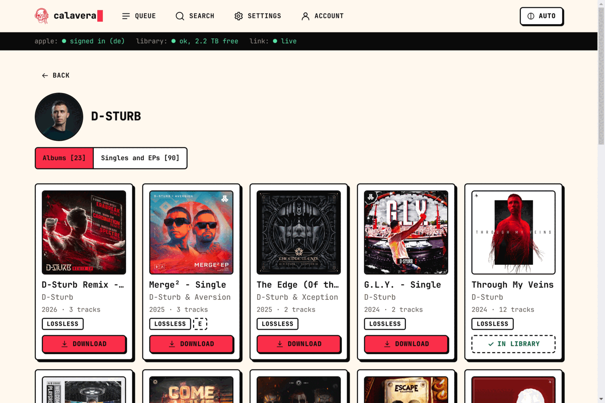
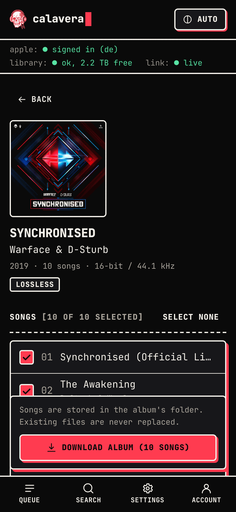

# Calavera

[](https://github.com/killparty/calavera/actions/workflows/ci.yml)
[](https://github.com/killparty/calavera/releases/latest)
[](LICENSE)

A small, self-hosted web UI that downloads albums and songs from Apple Music
into your own music library as FLAC.

Paste a link or search the catalogue, and Calavera downloads the lossless
version, converts it to FLAC, checks that the FLAC is bit-identical to the
original, and files it under `Artist/Album/` in your library without ever
overwriting what is already there.

<p>
  
  
</p>

## Before you use it

- You need an Apple ID with an active Apple Music subscription. Calavera
  downloads only what that subscription lets you play.
- Calavera is not affiliated with or endorsed by Apple. Apple Music is a
  trademark of Apple Inc.
- Whether using this is permitted for you depends on Apple's terms and the
  law where you live. That is yours to check, and the use is at your own
  risk.
- Calavera is a front end. The downloading and decryption are done by two
  separate projects, [amdl](https://github.com/zhaarey/apple-music-downloader)
  and [wrapper-lite](https://github.com/WorldObservationLog/wrapper/tree/lite),
  which are fetched when you build the images. Nothing of theirs is in this
  repository, and no ready-made images are published.

## What it does

- **Queue** album and song links, one at a time, with live progress and a
  per-job log. The queue survives restarts.
- **Search** the Apple Music catalogue, browse an artist's albums, and see
  which albums you already have. Artist and album names link to their pages
  everywhere, including the download history.
- **Choose songs.** Open an album to pick individual songs. Songs Apple lists
  but does not offer (greyed out in its own apps) are shown as such and left
  out automatically.
- **FLAC by default.** Each track is converted from Apple Lossless and
  verified to decode to identical audio before the original is deleted. Can be
  switched off to keep Apple Lossless (`.m4a`).
- **Hi-Res** up to 24-bit / 192 kHz, with a cap you set (96 kHz unless
  changed). An album's page says which quality Apple offers it in.
- **Synced lyrics, cover art and tags** embedded, using standard FLAC tag
  names.
- **Careful with your library.** Nothing existing is overwritten, renamed or
  deleted; an album whose folder already exists is skipped.
- **Sign in from the UI**, with two-factor code. The password is not stored.
- A neo-brutalist, terminal-flavoured interface with light and dark themes,
  a phone layout and an accent colour you choose (or none).
- **Considerate towards Apple's servers.** A page costs one or two catalogue
  requests, pages you return to are remembered for a while instead of asked
  for again, and if Apple asks for a pause, Calavera keeps it.

## How it works

Two containers:

| Container | Contents | Network |
|---|---|---|
| `wrapper` | [wrapper-lite](https://github.com/WorldObservationLog/wrapper/tree/lite), which holds the Apple Music session and does the decryption, plus a small supervisor that runs the sign-in | Compose network only |
| `app` | Calavera (API, queue, web UI), the [amdl](https://github.com/zhaarey/apple-music-downloader) downloader and ffmpeg | The web UI port |

A job runs through: download (amdl) → verify → convert to FLAC → import into
the library. More in [docs/ARCHITECTURE.md](docs/ARCHITECTURE.md).

## Requirements

- Linux on x86-64 with Docker Engine and the Compose plugin.
- About 1.5 GB for images, plus staging space for one album at a time.
- Building the `wrapper` image downloads about 1 GB and takes several minutes
  (wrapper-lite has no published releases and is compiled from source).

## Install

```bash
git clone https://github.com/killparty/calavera.git
cd calavera
cp .env.example .env      # then edit it, see below
mkdir -p data/staging
docker compose build
docker compose up -d
```

Open `http://<BIND_ADDRESS>:<WEB_PORT>`, go to **Account** (the status pill in
the top right) and sign in.

### `.env`

| Variable | Meaning |
|---|---|
| `BIND_ADDRESS` | Address the UI is published on: the host's LAN IP, or `127.0.0.1`. |
| `WEB_PORT` | Port of the UI. Default `8080`. |
| `LIBRARY_PATH` | Your music library. Must exist, must not be empty, and be writable by `PUID:PGID`. |
| `STAGING_PATH` | Scratch space for downloads in progress. Default `./data/staging`. |
| `TZ` | Timezone, e.g. `Europe/Berlin`. |
| `PUID` / `PGID` | Owner of the files written to the library (`id -u`, `id -g`). |

**The UI has no login of its own.** Anyone who can reach it can queue
downloads and start an Apple sign-in. Publish it on a trusted LAN address or on
`127.0.0.1` behind your own authenticating reverse proxy, never on a public
interface.

## Signing in

**Account → Sign in.** Enter the Apple ID and password; if Apple asks for
two-factor authentication a code field appears, with about a minute to enter
the 6-digit code.

- The password goes from your browser to Calavera, on to the wrapper
  container, and is handed to wrapper-lite as a command-line argument (the
  only interface it offers). It is not written to disk, not logged, and not
  kept in memory after the sign-in process has started. It is visible in the
  wrapper container's process list while the sign-in runs.
- The UI is served over plain HTTP. On a network you do not trust, use the
  terminal instead:
  `docker compose exec wrapper python3 /app/supervisor.py login`
- What is kept is Apple's session, in the `wrapper-session` Docker volume. It
  survives restarts and rebuilds, but not `docker compose down -v`.
- Apple IDs protected by hardware security keys cannot sign in: Apple issues
  no 6-digit codes for them.

## Using it

- **Queue:** paste one or more album or song links (one per line) and press
  *Add to queue*. With a single album link, *Choose songs* opens the album
  instead.
- **Search:** type an artist, album or song, or paste a link. *In library*
  marks albums whose folder already exists. Tap a cover or title to open the
  album, an artist's name to open the artist's page. There, a switch shows
  either the albums or the singles and EPs.
- **Getting the latest from Apple:** pages you return to are remembered for
  a while (a search or an artist page for 15 minutes, an album for an hour)
  instead of asked for again. Reloading the page in your browser, or
  pressing *Search*, asks Apple afresh.
- **Album page:** every song with a checkbox. Everything downloadable starts
  selected; untick what you do not want. Songs that are not available or are
  already in your library cannot be ticked and say why.
- **Settings:** FLAC on/off, highest sample rate, lyrics, cover size, metadata
  language, store for search. Under *Appearance*, the accent colour (a hue
  and a depth slider, or monochrome), whether the logo has its white fill,
  and a reset. These choices are kept in your browser, not on the server.

Job outcomes:

| Status | Meaning |
|---|---|
| In library | Downloaded, verified, and copied to the library. A *partial* tag means some songs of the album are not available on Apple Music; the card says how many. |
| Already in library | The album folder exists; nothing was changed and usually nothing was downloaded. *Add missing tracks* adds the songs the folder lacks. |
| Failed | See the message and the log. A track that fails unexpectedly stops the import: nothing partial is imported on its own. If some tracks did finish, *Keep N tracks* imports those; otherwise retry, discard or remove the job. |
| Canceled / Interrupted | Stopped by you, or by a restart. *Retry* runs it again. |

### Library rules

Albums are stored as `<library>/<Artist>/<Album>/NN. Title.flac` plus
`cover.jpg`.

- Existing files and folders are never overwritten, renamed or deleted.
- An existing artist folder is reused (matched case-insensitively).
- An existing album folder means a whole-album download is skipped.
- Tracks are added to an existing album folder only when you ask for exactly
  that: by choosing songs, by downloading a single song, or with *Add missing
  tracks* / *Keep N tracks*. Only tracks that are not there yet are added. A
  track counts as present if a file with the same name exists in any audio
  format, so an album you hold as `.m4a` is not doubled up with `.flac`
  files. An existing cover image is kept.
- Only verified tracks are imported. Songs Apple does not offer are left out
  up front and reported; any other failed track stops the import.
- If the library folder is missing, empty or read-only (for example an
  unmounted network share), nothing is written.
- The copy goes to a hidden temporary folder, every file is read back and
  checksummed, and only then is the folder renamed into place. Media servers
  that watch for new files may not notice a folder that appears this way;
  trigger a library scan if yours does not.

"Already exists" means *the same folder name*. `Album (Deluxe Edition)` and
`Album` are different albums, and so is an album you keep under another
naming scheme.

## Operating

```bash
docker compose ps
docker compose logs -f app        # or: wrapper
docker compose stop               # keep everything, stop running
docker compose down               # remove containers; session, queue and settings are kept
```

Kept across restarts and rebuilds: the Apple session (`wrapper-session`
volume), the queue, history and settings (`data/calavera.db`).

`docker compose down -v` deletes the Apple session (you would have to sign in
again).

### Updating Calavera

New versions are listed under
[Releases](https://github.com/killparty/calavera/releases). In the folder
you cloned:

```bash
git pull
docker compose build
docker compose up -d
```

Your `.env`, the Apple session, the queue, history and settings are kept.
A download that is running is interrupted by the restart; *Retry* runs it
again. To stay on a particular version instead of the latest state, use
`git checkout v0.4.0` (for example) in place of `git pull`.

### Updating the pinned components

Versions are pinned in `compose.yaml` and `app/Dockerfile`:

| Component | Pin | Where |
|---|---|---|
| wrapper-lite | commit `2fd7e0eaef081f93cf687428b965674937832ba4` | `compose.yaml` → `wrapper.build.args.WRAPPER_REF` |
| amdl | release `v0.1.0` + SHA-256 of the binary | `compose.yaml` → `app.build.args` |
| ffmpeg | static 7.1, image digest | `app/Dockerfile` |
| Python packages | direct ones in `requirements.in`, full lock generated | `app/backend/requirements.txt` |
| JavaScript packages | lockfile | `app/frontend/package-lock.json` |

Change a pin, then `docker compose build && docker compose up -d`. After
changing amdl, download one album and check the result: Calavera reads amdl's
terminal output (see `app/backend/calavera/amdl.py`).

There is no need to follow every upstream release. Update when something
stops working (Apple changes things; the fix arrives upstream) or when you
want a new feature.

#### Finding out about updates

If you keep your copy as a repository on GitHub (a fork, for example), two
things in it watch for updates:

- **`.github/workflows/upstream-check.yml`** runs every Monday and compares
  the amdl and wrapper-lite pins with upstream. If either is behind it opens
  an issue (label `upstream`) with the new version, the changes, and the
  exact lines to put into `compose.yaml`, including amdl's checksum. One
  issue per component; it adds a comment if upstream moves again. It never
  changes anything itself. Run it by hand under *Actions → Upstream check →
  Run workflow*, or locally with
  `DRY_RUN=1 .github/scripts/check-upstream.sh` (needs `curl` and `jq`).
- **Dependabot** (`.github/dependabot.yml`) opens weekly pull requests for
  Calavera's own dependencies: Python and JavaScript packages (minor and
  patch versions, grouped), Docker base images and GitHub Actions. Image
  tags set through build arguments (`PYTHON_VERSION`, `NODE_VERSION`,
  `DEBIAN_VERSION`) and the ffmpeg digest are not updated by it.

## Known limits

- Album and song links only. Playlists, artist "download everything", Dolby
  Atmos, AAC and music videos are not supported.
- One download at a time.
- A single song is stored in its album's folder. A later whole-album download
  is then reported as *Already in library*; use *Add missing tracks* to get
  the rest.
- Whether a track is "already there" is decided by file name (track number
  and title). Tracks you named differently are not recognised.
- No built-in login (see above) and no HTTPS.
- Search uses an anonymous token taken from Apple's web player, the same way
  amdl does. If Apple changes the web player, search stops working until
  `app/backend/calavera/catalog.py` is updated; downloads by link keep working.
- wrapper-lite needs three relaxed Docker security options (see
  `compose.yaml`). It does not run privileged.
- Developed and in daily use on Debian 12 with Docker Engine. Other Linux
  distributions should work but are untested, as are rootless Docker,
  Podman, SELinux hosts and ARM.

## Development

See [docs/DEVELOPMENT.md](docs/DEVELOPMENT.md). For bug reports and pull requests see
[CONTRIBUTING.md](CONTRIBUTING.md); for security problems,
[SECURITY.md](SECURITY.md).

## Credits

Calavera is a front end. The hard parts are done by
[amdl](https://github.com/zhaarey/apple-music-downloader) and
[wrapper-lite](https://github.com/WorldObservationLog/wrapper), which Calavera
downloads at build time and does not redistribute.

## Licence

Copyright © 2026 killparty.

Calavera is free software, licensed under the GNU Affero General Public
License, version 3 (`AGPL-3.0-only`). See [LICENSE](LICENSE).

In short: you may use, change and share it, but if you distribute a changed
version or let other people use one over a network, you must make your
source code available to them under the same licence. The Settings page links
to the source for that reason; if you run a modified copy for others, point
that link at your own source (`SOURCE_URL` in
`app/frontend/src/pages/Settings.tsx`).

The licence covers Calavera's own code. amdl, wrapper-lite and ffmpeg are
separate programs under their own terms, fetched when the images are built.
